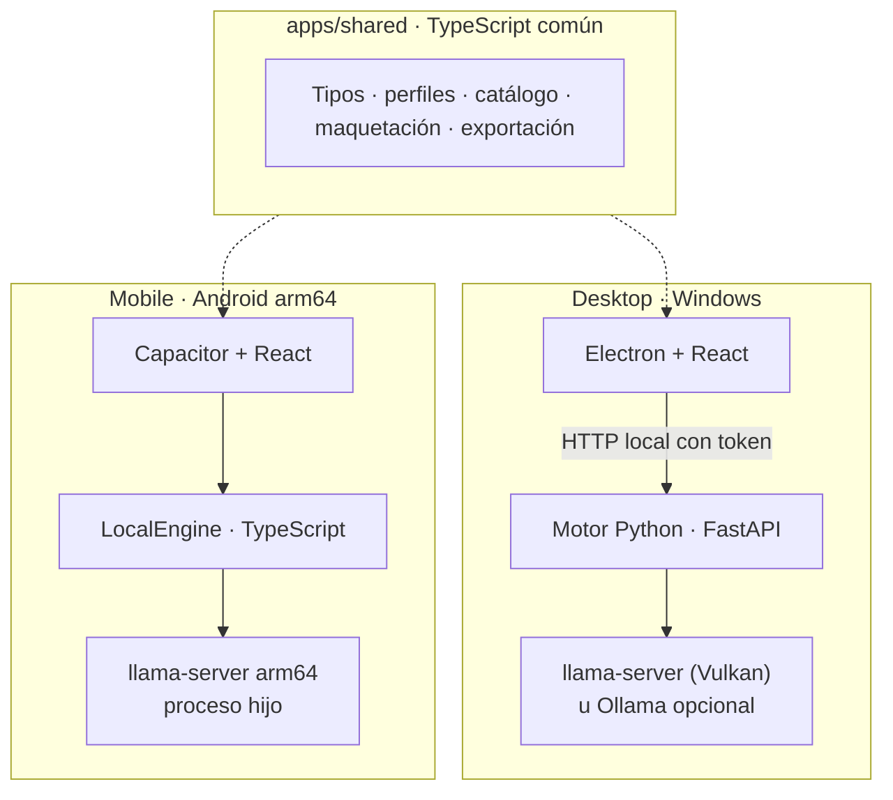
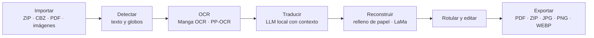

<div align="center">

<!-- BANNER Y LOGO: pendientes del archivo original del logo oficial (rombo de cristal azul y morado).
     No sustituir por otra marca. Ver assets/readme/README.md. -->

# STARBLITZ

**Translate beyond words.**

Traductor contextual de mangas, manhwas, manhuas y cómics al español, **100 % local y gratuito**.


-A169E0?labelColor=0D142A)


[Estado](#estado-y-versión) · [Características](#características) · [Arquitectura](#arquitectura) · [Instalación](#instalación-y-configuración) · [Descargas](#descargas-y-versiones) · [Documentación](#documentación) · [Hoja de ruta](#hoja-de-ruta)

</div>

---

STARBLITZ detecta los globos y textos de cada página, los lee con OCR especializado, los traduce con un modelo de lenguaje
que entiende el contexto de la obra (personajes, glosario, páginas anteriores y la propia escena), borra el texto original
reconstruyendo el dibujo y rotula la traducción ajustada a la forma de cada globo. **La traducción siempre se ejecuta en tu
equipo**: sin cuentas, sin suscripciones y sin enviar tus archivos a ningún servidor. Hugging Face se usa solo como
catálogo y fuente de descarga de modelos.

## Estado y versión

> [!WARNING]
> **Versión 1.0.0, sin publicar.** El código está completo y probado con pruebas automáticas, pero **nada está validado
> todavía en hardware real**: no hay APK compilado, el instalador de Windows no se ha generado y no se ha medido la
> calidad de traducción. Ver [LIMITACIONES](docs/LIMITACIONES.md).

Leyenda: 🔨 compilado · 🧪 pruebas automáticas o simuladas · ✅ verificado en hardware real · ⏳ pendiente

| Producto | Qué es | Compilación | Pruebas | Hardware real |
|---|---|---|---|---|
| **STARBLITZ Desktop** (Windows 10/11 x64) | App con motor propio (Python + ONNX Runtime + llama.cpp con Vulkan): proyectos, lotes, editor, exportación y gestor de modelos | 🔨 portátil · ⏳ instalador | 🧪 | ⏳ |
| **STARBLITZ Mobile** (Android 9+, arm64) | App nativa **independiente del PC**: importa, procesa, edita y exporta en el teléfono | ⏳ APK sin compilar | 🧪 | ⏳ |
| **Motor Python** (`engine/`) | Servicio local del escritorio: detección, OCR, traducción contextual y reconstrucción | — | 🧪 (parte requiere modelos reales) | ⏳ |

Detalle por prueba: [PRUEBAS](docs/PRUEBAS.md) y [PRUEBAS-HARDWARE](docs/PRUEBAS-HARDWARE.md).

## Características

<table>
<tr>
<td width="50%" valign="top">
<br>
<b>Traducción con contexto</b><br>
Ficha de la obra, personajes con su forma de hablar, glosario obligatorio y memoria de lo ocurrido. Dos pasadas
(traductor y corrector) en «Calidad máxima».
</td>
<td width="50%" valign="top">
<br>
<b>IA local</b><br>
OCR, visión y traducción en tu equipo con llama.cpp y ONNX Runtime. Eliges y descargas los modelos que quieras.
</td>
</tr>
<tr>
<td width="50%" valign="top">
<br>
<b>Privacidad total</b><br>
Sin telemetría ni cuentas. Lo único que sale a Internet es la descarga de modelos que tú pides.
</td>
<td width="50%" valign="top">
<br>
<b>Revisión honesta</b><br>
Nunca inventa: si el OCR falla o la frase es ambigua, la marca para revisión. Lo que apruebas o editas no se sobrescribe.
</td>
</tr>
</table>

- **Proyecto completo como un solo trabajo**: ZIP, CBZ, PDF, JPG, PNG o WEBP (hasta 50 páginas por proyecto, ajustable);
  progreso por página, pausa, reanudación y recuperación tras cierres inesperados.
- **Perfiles de traducción**: Natural (por defecto), Fiel, Coloquial, Formal y Adaptación narrativa, más un
  **diccionario personal** global.
- **Español latinoamericano neutro** por defecto (también de España).
- **Ecosistema de modelos**: busca en Hugging Face, compara con tu dispositivo (RAM, tamaño, cuantización, licencia),
  descarga con reanudación y verificación SHA-256. Ver [MODELOS](docs/MODELOS.md).
- **Exportación** a PDF, ZIP, JPG, PNG o WEBP.

<!-- Capturas: sin galería hasta que existan capturas reales y verificadas (ver assets/screenshots/README.md). -->

## Arquitectura

Dos motores independientes comparten formato de proyecto, perfiles, catálogo de modelos, maquetación y exportación
(`apps/shared`). El móvil no necesita el PC.



Flujo de procesamiento (idéntico en ambos motores):



Más en [ARQUITECTURA](docs/ARQUITECTURA.md), [ENGINE](docs/ENGINE.md), [DESKTOP](docs/DESKTOP.md) y [ANDROID](docs/ANDROID.md).

## Tecnologías

| Capa | Tecnologías |
|---|---|
| Escritorio | Electron 38, React 19, TypeScript, Vite |
| Móvil | Capacitor 7, React 19, TypeScript, plugin nativo Java, OpenCV.js, ONNX Runtime Web |
| Motor | Python (FastAPI, Uvicorn, Pydantic), ONNX Runtime (DirectML en Windows), OpenCV, PDFium |
| Modelos | comic-text-detector, Manga OCR, PP-OCR (RapidOCR), LaMa, modelos GGUF vía llama.cpp (Vulkan en PC, arm64 en Android) |
| Herramientas | npm workspaces, vitest, pytest, GitHub Actions |

Licencias de terceros: [LICENCIAS-TERCEROS](docs/LICENCIAS-TERCEROS.md).

## Requisitos del sistema

| | Windows (Desktop) | Android (Mobile) |
|---|---|---|
| Sistema | Windows 10 21H2 x64 o superior | Android 9 (API 28) o superior |
| Procesador / GPU | CPU (más lento) o GPU con Vulkan/DirectX 12 | **arm64-v8a** (x86 no puede traducir) |
| RAM | 8 GB mínimo · 16 GB o más recomendado | 4 GB mínimo · 6–8 GB recomendado |
| Disco | ~0,7 GB app + ~0,8 GB visión + 1,3–15 GB modelo de lenguaje | ~0,3 GB app + 1,3 GB modelo mínimo |

Detalle: [INSTALACION](docs/INSTALACION.md).

## Instalación y configuración

<details>
<summary><b>Windows</b></summary>

1. Abre `STARBLITZ.exe` (versión portátil) o el instalador cuando exista una Release. Windows SmartScreen avisará porque
   el ejecutable no está firmado.
2. En **Inicio** pulsa **Descargar lo necesario**: detector de texto, Manga OCR, LaMa y el modelo de traducción
   recomendado para tu equipo. Es una descarga única.
3. En **Modelos → Avanzado → Origen del modelo** deja «Integrado en STARBLITZ».

Guía completa: [INSTALACION](docs/INSTALACION.md#windows) · [DESKTOP](docs/DESKTOP.md)
</details>

<details>
<summary><b>Android</b></summary>

1. Obtén el APK (compílalo con `scripts\Compilar-APK-Android.bat` o descárgalo de una Release cuando exista).
2. Cópialo al teléfono y ábrelo (permite instalar apps desconocidas para tu gestor de archivos).
3. En **Modelos**, descarga el detector (pestaña Visión) y un modelo de lenguaje con Wi‑Fi y cargador.

Guía completa: [INSTALACION](docs/INSTALACION.md#android) · [ANDROID](docs/ANDROID.md)
</details>

<details>
<summary><b>Desde el código fuente</b></summary>

```bash
npm ci
python -m venv .venv && .venv/bin/pip install -r engine/requirements.txt onnxruntime pytest onnx
.venv/bin/pip install --no-deps rapidocr==3.10.0
npm run typecheck && npm test
```

Más en [COMPILAR](docs/COMPILAR.md) y [CONTRIBUTING](CONTRIBUTING.md).
</details>

## Guía de uso

1. **Importa** un ZIP, CBZ, PDF o imágenes (arrástralos en Windows; botón ★ en Android).
2. Elige **idioma de origen**, **variante de español** y **perfil de traducción**.
3. Pulsa **Traducir proyecto**: verás progreso por página, errores y tiempo estimado; puedes pausar y reanudar.
4. **Revisa** en el editor (lo dudoso aparece marcado) y ajusta textos o rotulación.
5. **Exporta** a PDF, ZIP, JPG, PNG o WEBP.

## Descargas y versiones

**Aún no hay versiones publicadas.** Las versiones finales se distribuirán con
[GitHub Releases](../../releases), nunca dentro del historial de Git, y solo cuando sus pruebas estén completadas y
documentadas.

| Archivo previsto | Contenido |
|---|---|
| `STARBLITZ-Setup-<versión>.exe` | Instalador de Windows (sin firma digital) |
| `STARBLITZ-win-x64-portable.zip` | Versión portátil de Windows |
| `STARBLITZ-<versión>-android-arm64.apk` | APK de Android (arm64) |
| `SHA256SUMS.txt` | Sumas SHA-256 de todos los archivos |

Verifica siempre la descarga:

```powershell
Get-FileHash .\STARBLITZ-Setup-<versión>.exe -Algorithm SHA256   # compara con SHA256SUMS.txt
```

Historial de cambios: [CHANGELOG](CHANGELOG.md).

## Estructura del repositorio

```
.github/           Workflows (ci, build, validacion, release en borrador) y plantillas de issues y PR
apps/
  desktop/         App de escritorio (React + Electron)
  mobile/          App Android (React + Capacitor): motor local TypeScript, plugin nativo y proyecto android/
  shared/          Código común TypeScript: tipos, cliente del motor, maquetación, exportación, catálogo y perfiles
assets/            Recursos del README (iconos; el banner está pendiente) y capturas verificadas
brand/             Logotipo, icono y splash usados por las apps y el instalador
docs/              Documentación técnica y de usuario
engine/            Motor Python (FastAPI + ONNX Runtime + llama.cpp) y sus pruebas
scripts/           Compilación de Windows, instalador NSIS, APK de Android y comprobaciones de CI
tools/             Preparación de llama.cpp y OCR para Android y generación de datos compartidos Python ↔ TypeScript
```

Las pruebas viven junto al código: `engine/tests/`, `apps/*/test/` y `apps/*/e2e/`.

## Privacidad y funcionamiento local

- Sin telemetría y sin cuentas. Los proyectos viven en el almacenamiento privado de la app.
- La traducción, el OCR y la visión se ejecutan en tu equipo.
- Salidas a Internet: solo la descarga de modelos que tú pides (Hugging Face; el detector desde su publicación original;
  en escritorio, el OCR coreano desde ModelScope vía RapidOCR).
- Si configuras un servidor de lenguaje externo (Ollama, LM Studio u OpenAI-compatible) y es remoto, tus textos salen del
  equipo por decisión tuya. El modo por defecto es local.

Detalle y política de seguridad: [ARQUITECTURA](docs/ARQUITECTURA.md#seguridad) · [SECURITY](SECURITY.md).

## Hoja de ruta

Resumen (detalle en [ROADMAP](docs/ROADMAP.md)):

- ⏳ Ejecutar las pruebas en hardware real ([PRUEBAS-HARDWARE](docs/PRUEBAS-HARDWARE.md)).
- ⏳ Compilar el APK firmado y generar el instalador de Windows.
- ⏳ Medir la calidad de traducción con modelos reales.
- ⏳ Capturas verificadas, banner con el logo oficial, licencia confirmada y primera Release.

## Documentación

| Documento | Contenido |
|---|---|
| [INSTALACION](docs/INSTALACION.md) | Requisitos e instalación en Windows y Android |
| [ARQUITECTURA](docs/ARQUITECTURA.md) | Diseño, decisiones técnicas y seguridad |
| [DESKTOP](docs/DESKTOP.md) · [ANDROID](docs/ANDROID.md) · [ENGINE](docs/ENGINE.md) | Cada producto en detalle |
| [MODELOS](docs/MODELOS.md) | Modelos, Hugging Face y calidad de traducción |
| [COMPILAR](docs/COMPILAR.md) | Compilar Windows, Android y CI |
| [PRUEBAS](docs/PRUEBAS.md) · [PRUEBAS-HARDWARE](docs/PRUEBAS-HARDWARE.md) | Pruebas realizadas y pendientes |
| [LIMITACIONES](docs/LIMITACIONES.md) · [FAQ](docs/FAQ.md) · [ROADMAP](docs/ROADMAP.md) | Qué falta y preguntas frecuentes |
| [MOTOR-AUDITORIA](docs/MOTOR-AUDITORIA.md) · [MODELOS-INVESTIGACION](docs/MODELOS-INVESTIGACION.md) · [DISENO-FASES-5-7](docs/DISENO-FASES-5-7.md) | Auditoría del motor, comparativa de modelos (sin ganador aún) y diseño de segundo plano y actualizador |
| [CONTRIBUTING](CONTRIBUTING.md) · [SECURITY](SECURITY.md) · [CHANGELOG](CHANGELOG.md) | Contribuir, seguridad e historial |

## Créditos y licencia

STARBLITZ se apoya en proyectos de código abierto (llama.cpp, ONNX Runtime, OpenCV, PaddleOCR/RapidOCR, Manga OCR, LaMa,
Electron, React, Capacitor y otros). Sus créditos y licencias están en [LICENCIAS-TERCEROS](docs/LICENCIAS-TERCEROS.md).

**Licencia del proyecto: pendiente de confirmación por el titular.** Consulta el archivo [LICENSE](LICENSE) del
repositorio. Los modelos y tipografías tienen sus propias licencias.
