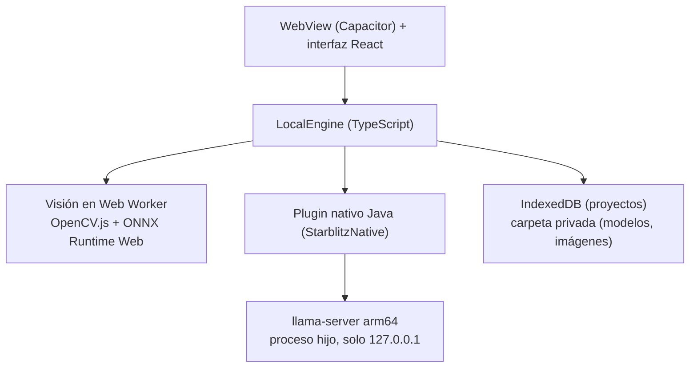

# STARBLITZ Mobile (Android)

Aplicación Android (9+, **arm64-v8a**) **independiente del PC**: importa, procesa (visión y traducción), edita y exporta
en el propio teléfono.

> **Estado:** 🧪 código y lógica probados con pruebas automáticas y E2E en Chromium · ⏳ **APK nunca compilado ni
> instalado** · ⏳ `llama-server` arm64 nunca ejecutado en un teléfono real (ver [LIMITACIONES](LIMITACIONES.md)).
> **No hay Releases publicadas.**

## Cómo funciona

- **Motor local** (`apps/mobile/src/engine/`): misma API que el motor Python; trabajo de proyecto con pausa,
  reanudación y recuperación; `DeviceStatusGuard` pausa por batería ≤ 10 % sin cargador, calor o poco espacio.
- **Visión:** detector de texto, PP-OCR (incluido) y Manga OCR / LaMa opcionales, con WebAssembly y hilos.
- **Traducción:** `llama-server` de llama.cpp (b12017, arm64) con modelos GGUF Q4/Q5; si Android lo cierra por memoria,
  la app lo relanza.
- **Privacidad:** sin telemetría; permisos solo `INTERNET`, `ACCESS_NETWORK_STATE` y `VIBRATE` (vibración háptica; permiso normal, sin avisos); `allowBackup=false`.

## Requisitos

| | Mínimo | Recomendado |
|---|---|---|
| Sistema | Android 9 (API 28) | Android 12 o superior |
| Procesador | arm64-v8a | Chip reciente con dotprod/i8mm |
| RAM | 4 GB (modelo de 2 B, lento y limitado) | 6–8 GB (4 B) o ≥ 10 GB (9 B) |
| Almacenamiento libre | ~0,3 GB app + 1,3 GB modelo 2 B + visión opcional | ≥ 6 GB |

Los equipos x86/x86_64 (emuladores) abren la app pero **no pueden traducir**. Detalle en
[INSTALACION](INSTALACION.md#android).

## Instalar y usar

1. Obtén el APK (compilándolo o, cuando exista, desde una Release; comprueba su SHA-256 con `SHA256SUMS.txt`).
2. Cópialo al teléfono y ábrelo (permite instalar apps desconocidas para tu gestor de archivos).
3. En **Modelos**, la app mide el teléfono y propone perfil y modelo; descarga el detector (pestaña Visión) y un modelo
   de lenguaje con Wi‑Fi y cargador.
4. Importa con el botón ★ (ZIP, PDF o imágenes), pulsa **Traducir proyecto** y exporta a «Descargas/STARBLITZ»
   (Android 10+) o comparte (Android 9).

## Compilar el APK

Ver [COMPILAR](COMPILAR.md#android). Opciones: `scripts\Compilar-APK-Android.bat` en Windows,
GitHub Actions (`build.yml`, manual o desde `release.yml`) o Android Studio.

- **Componentes nativos versionados:** `apps/mobile/android/app/src/main/jniLibs/arm64-v8a/*.so` (llama.cpp b12017, con
  `apps/mobile/android/app/vendor/llama-libs.sha256` y `LLAMA-CPP-LICENSE.txt`); regenerables con
  `tools/prepare_llama_android.sh`.
- **OCR:** `apps/mobile/public/models/ppocr-rec.onnx` no se versiona; se regenera con `tools/prepare_ppocr.sh`
  (descarga con SHA-256 fijado).
- **Firma:** el APK de producción se firma con la clave del titular. `build.gradle` lee `SB_KEYSTORE`,
  `SB_KEYSTORE_PASSWORD`, `SB_KEY_ALIAS` (por defecto **`starblitz`**) y `SB_KEY_PASSWORD` (por defecto, la del almacén).
  En GitHub Actions solo se pasan el keystore (`ANDROID_KEYSTORE_B64`) y su contraseña (`ANDROID_KEYSTORE_PASSWORD`): el
  keystore debe usar el alias `starblitz` y la misma contraseña para almacén y clave. `release.yml` exige firma; sin ella
  `build.yml` solo produce un APK de depuración. Guarda la clave fuera del repositorio: sin ella no podrás actualizar la
  app instalada. Detalle en [COMPILAR](COMPILAR.md#firma-del-apk).
- **Versión:** `versionName` `1.0.0` (igual que el producto) y `versionCode` `1`; el `versionCode` solo debe crecer con
  cada APK publicado. Ver [COMPILAR](COMPILAR.md#versiones).

## Pruebas pendientes

La lista A1–A… de [PRUEBAS-HARDWARE](PRUEBAS-HARDWARE.md) (instalación, arranque de `llama-server`, modo avión, capítulo
completo, batería y temperatura) está **pendiente en teléfonos reales**.
