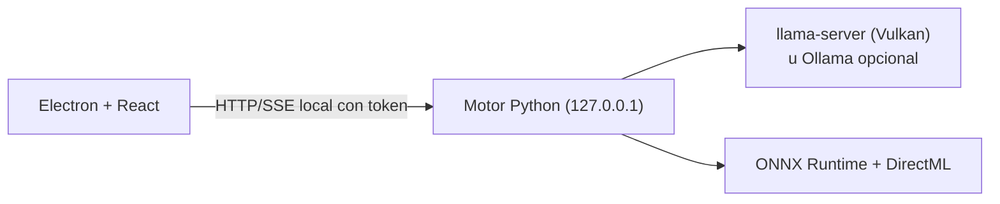

# STARBLITZ Desktop (Windows)

Aplicación de escritorio para Windows 10 21H2 / 11 x64: Electron + React para la interfaz y el motor Python
([ENGINE](ENGINE.md)) como servicio local.

> **Estado:** 🔨 versión portátil generada en el equipo del titular · ⏳ instalador NSIS no generado ni probado ·
> ⏳ no verificado en Windows con GPU y modelos reales (ver [LIMITACIONES](LIMITACIONES.md)).
> **No hay Releases publicadas.**

## Qué incluye

- Proyectos con progreso por página, pausa, reanudación y recuperación tras cierres inesperados.
- Importación de ZIP, CBZ, PDF, JPG, PNG y WEBP (hasta 50 páginas por proyecto, ajustable).
- Editor con lo dudoso marcado, deshacer/rehacer por sesión y rotulación ajustada al globo.
- Exportación a PDF, ZIP, JPG, PNG o WEBP.
- Gestor de modelos: búsqueda en Hugging Face, comparación con tu equipo, descarga reanudable con SHA-256.
- Perfiles de traducción y diccionario personal.

## Instalación y primer uso

Requisitos y pasos detallados: [INSTALACION](INSTALACION.md#windows). En resumen:

1. Abre `STARBLITZ.exe` (versión portátil) o instala el instalador cuando exista una Release.
   Windows SmartScreen avisará porque el ejecutable no está firmado.
2. En **Inicio**, pulsa **Descargar lo necesario** (detector, Manga OCR, LaMa y el modelo de traducción recomendado).
3. En **Modelos → Avanzado → Origen del modelo** deja «Integrado en STARBLITZ».
4. Arrastra tus páginas, elige idioma de origen, variante de español y perfil, y procesa.
5. Revisa en el **Editor** y **exporta**.

## Dónde se guardan los datos

- Instalado: `%APPDATA%\STARBLITZ` (el desinstalador conserva proyectos y modelos).
- Portátil: carpeta `data` junto al ejecutable, si existe `portable.txt`.

## Arquitectura



Código: `apps/desktop/` (`electron/` proceso principal, preload y arranque del motor; `src/` interfaz con `views/`,
`components/` y `editor/`; `e2e/` pruebas de interfaz) y `apps/shared/` (código común).

## Compilar

```bash
bash scripts/build-windows.sh              # portátil autocontenido en dist/STARBLITZ-win-x64/
bash scripts/build-installer.sh            # instalador NSIS (dist/STARBLITZ-Setup-<versión>.exe)
```

Detalle y CI en [COMPILAR](COMPILAR.md). Las pruebas de instalación y rendimiento en equipo real están en
[PRUEBAS-HARDWARE](PRUEBAS-HARDWARE.md).

## Seguridad

`contextIsolation` y `sandbox` activados, sin `nodeIntegration`, navegación restringida, permisos denegados y CSP
estricta. El motor solo escucha en `127.0.0.1`. Ver [ARQUITECTURA](ARQUITECTURA.md#seguridad).
