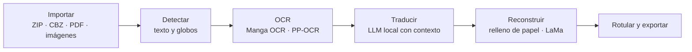

# Motor de procesamiento y traducción

El motor de escritorio (`engine/`, paquete `starblitz_engine`) es un servicio local en Python que expone una API HTTP en
`127.0.0.1`. La interfaz de Electron habla con él mediante HTTP/SSE con un token de sesión aleatorio por arranque. El
móvil tiene un motor propio en TypeScript con la misma API y paridad verificada por pruebas
(ver [ARQUITECTURA](ARQUITECTURA.md)).

> **Estado:** 🧪 probado con pruebas automáticas (parte con modelos simulados) · ⏳ calidad de traducción y rendimiento
> reales sin medir. Ver [LIMITACIONES](LIMITACIONES.md) y [PRUEBAS](PRUEBAS.md).

## Flujo de procesamiento



1. **Importación.** El tipo se decide por firma binaria, no por extensión. Orden natural de páginas, PDF a resolución
   nativa, detección de duplicados exactos (SHA-1) y similares (dHash) y límites de ZIP (entradas, tamaño, ratio de
   compresión) y de megapíxeles.
2. **Detección.** Modelo `comic-text-detector` (ONNX) con post-procesado propio: bloques, líneas verticales y
   horizontales y máscara de texto; después viñetas, orden de lectura (manga: derecha a izquierda), globo de cada texto y
   tipo (diálogo, narración, SFX…).
3. **OCR.** Manga OCR (ONNX) para japonés, con respaldo en PP-OCR (incluido); PP-OCR para el resto de idiomas.
4. **Traducción.** Un modelo de lenguaje local recibe ficha de la obra, perfil de traducción, glosario del proyecto,
   diccionario personal, personajes, resumen y las páginas anterior y siguiente. Devuelve JSON validado con marcas de
   duda (`ambiguous`, `ocr_suspect`, `wordplay`, `too_long`…) y confianza. Lo aprobado o editado nunca se sobrescribe.
   Con «Calidad máxima» hay una segunda pasada de corrección.
5. **Reconstrucción.** Máscara de texto ∩ entorno de las líneas ∩ interior del globo; relleno con muestras de papel o
   LaMa; nada fuera de la máscara se modifica.
6. **Rotulación y exportación.** Canvas TypeScript compartido (lo que ves en el editor es lo que se exporta) y
   exportación a PDF, ZIP, JPG, PNG o WEBP.

## Traducción con modelos locales

- **Servidor de lenguaje:** `llama-server` de llama.cpp con Vulkan (empaquetado en el escritorio) o, de forma opcional,
  Ollama, LM Studio o cualquier servidor compatible con OpenAI configurado por el usuario.
- **Perfiles de dispositivo** (`low`, `mid`, `high`, `pc-gpu`): fijan contexto del modelo, uso de visión, calidad,
  OCR y reconstrucción. Si faltan modelos o el perfil no los admite, el motor aligera automáticamente
  (Manga OCR → PP-OCR, LaMa → relleno).
- **Prompts:** una sola fuente (`engine/starblitz_engine/translate/prompts.py`) exportada a JSON para TypeScript.
- **Modelos:** el catálogo y la descarga con reanudación y SHA-256 se describen en [MODELOS](MODELOS.md).

## Organización del paquete

| Carpeta (`engine/starblitz_engine/`) | Responsabilidad |
|---|---|
| `api/` | Aplicación FastAPI y contexto de la API |
| `core/` | Descargas, errores, sistema de archivos, hardware, identificadores, trabajos, ONNX, rutas y ajustes |
| `importers/` | Importación de ZIP, CBZ, PDF e imágenes |
| `vision/` | Detector, viñetas, orden de lectura, OCR |
| `translate/` | Prompts y traducción contextual |
| `llm/` | Cliente y gestión del servidor de lenguaje |
| `models/` | Registro y catálogo de modelos |
| `pipeline/` | Orquestación de las etapas por página |
| `projects/` | Esquema y almacenamiento de proyectos |
| `render/` | Reconstrucción del fondo |

Las pruebas viven en `engine/tests/` (API de extremo a extremo, detección por teselas, importación, trabajos,
maquetación, pila LLM, Manga OCR, perfiles, traducción y exportación del registro de visión) con servidores simulados
(`fake_llama_server.py`, `fake_hf.py`). Parte de ellas requiere modelos reales y se omite por defecto.

## Ejecutar en desarrollo

```bash
cd engine
STARBLITZ_TOKEN=dev python -m starblitz_engine --port 47811 --ui-dir ../apps/desktop/dist
# http://127.0.0.1:47811/?token=dev
```

Dependencias y pruebas: [COMPILAR](COMPILAR.md) y [CONTRIBUTING](../CONTRIBUTING.md).

## Formato de proyecto

`projects/<id>/project.json` y `pages/<id>/{original.*, thumb.webp, mask.png, clean.png, page.json}` con escritura
atómica. Esquema en `engine/starblitz_engine/projects/schema.py` y `apps/shared/src/types.ts` (idénticos).

## Seguridad y privacidad

Solo escucha en `127.0.0.1`; token de 256 bits por arranque; identificadores validados; ZIP sin extraer a disco con
límites. El motor no envía textos ni imágenes fuera del equipo salvo a un servidor de lenguaje que el usuario configure
explícitamente. Ver [ARQUITECTURA](ARQUITECTURA.md#seguridad).
